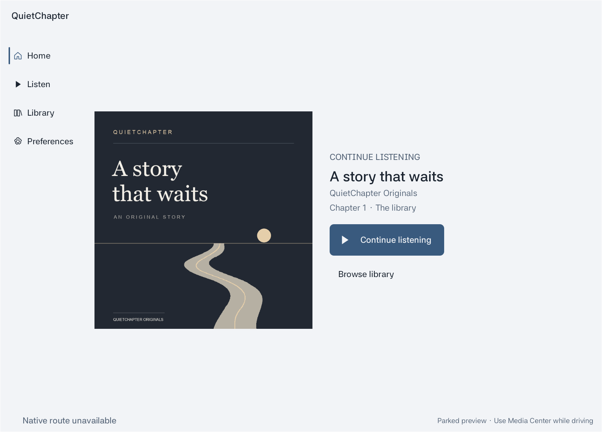
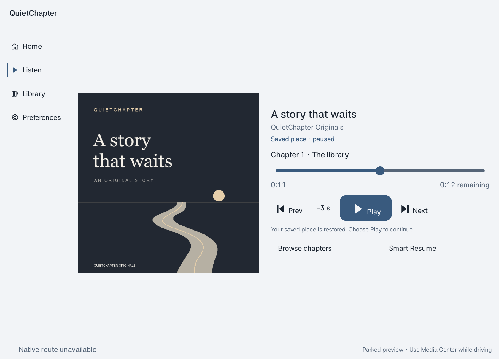
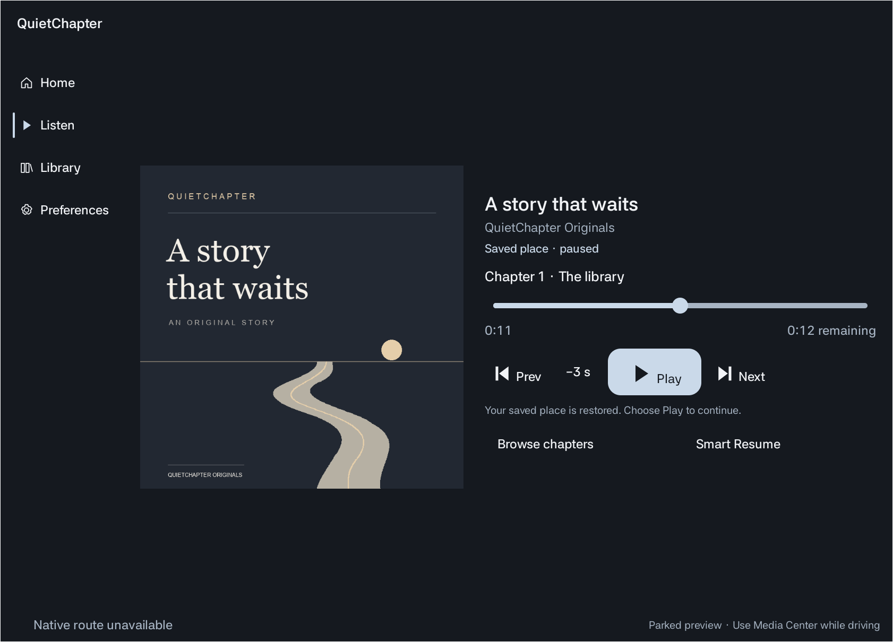
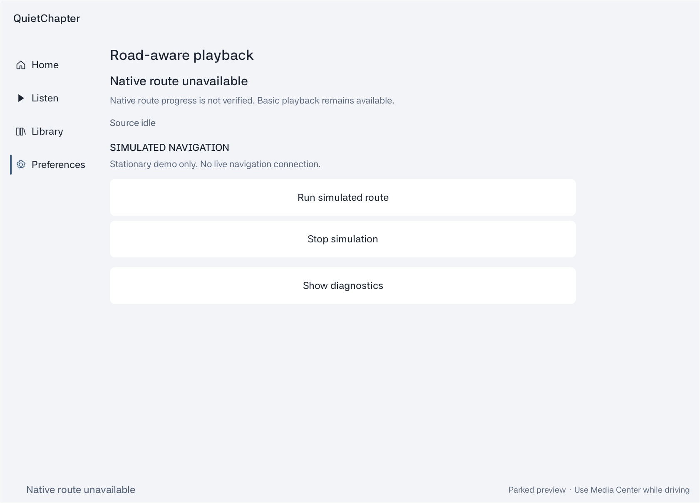

# QuietChapter

QuietChapter is an Android audiobook prototype for Pleos Connect research. It explores how spoken-word playback can preserve narrative continuity when a reliable road-context interruption is available, while keeping user intent and Android audio policy in control.

The project is presented for Hyundai Motor Group In-Vehicle App Development Challenge review. It is a prototype, not a production navigation service or a certified in-vehicle application.



## What is implemented

- A single service-owned Media3 ExoPlayer in a `MediaLibraryService`.
- `MediaLibrarySession` browsing with an original bundled audiobook, chapters, play/pause, seek, previous/next, and bookmark restoration.
- A parked application UI with Media Browser control from the activity and metadata suitable for automotive media hosts.
- Deterministic playback policy: user Pause, audio-focus loss, phone calls and source loss block automatic resume.
- Cached narrative-boundary metadata for the original demo. Smart Recovery is advisory and bounded: it may choose an already-heard safe boundary or use a conservative exact-position/fixed-rewind fallback. It never generates, rewrites, or skips narration.
- A clearly labelled simulated road-context demonstration for deterministic policy testing.

## Current prototype status

| Capability | Status |
| --- | --- |
| Media3 library, chapters, controls and saved position | Implemented and emulator-tested |
| Native Pleos Media Center discovery and browsing | Emulator-tested with the bundled demo |
| Narrative Recovery for the bundled demo | Implemented and unit-tested |
| Automatic adaptation from simulated road context | Implemented; **simulated only** |
| Genuine FusedLocation callback observation | Independently observed in a private emulator experiment; not connected to playback here |
| Authoritative native Pleos route identity/progression | Blocked by unavailable verified contract |
| Production user content import on Pleos | Blocked by the emulator picker limitation |
| Physical speaker-quality qualification | Not verified |





## Architecture

The application activity is a Media Browser client. Playback ownership remains inside `PlaybackService`, which owns the only ExoPlayer and exposes a `MediaLibrarySession`. The policy layer accepts only fresh, admitted context; it cannot establish native route identity itself. Narrative metadata is cached before playback and is advisory to the deterministic controller.

See [architecture](docs/ARCHITECTURE.md), [verification](docs/VERIFICATION.md), and [known limitations](docs/LIMITATIONS.md).

## Build

Requirements: Android Studio or JDK 17, Android SDK 36, and network access to Google and Maven Central for a first dependency resolution.

```bash
./gradlew :app:assembleDebug :app:testDebugUnitTest :app:lintDebug
```

The output APK is generated under `app/build/outputs/apk/debug/`. It is not a Pleos App Market package and is not included in this repository.

## Testing

On 2026-11-06, the preserved source baseline passed 195 application unit tests, 54 isolated location-matcher tests in the private development workspace, a debug build, and Android lint. The public snapshot is verified separately with the app build, app unit tests, and lint; results are recorded in [verification](docs/VERIFICATION.md).

The screenshots are authentic official Pleos emulator captures of QuietChapter-owned surfaces. The Road Context screen below explicitly shows the prototype's simulation status.



## Scope and rights

This repository is provided for competition evaluation. It contains no Pleos SDK binary, native Navigation UI, proprietary vehicle data, private emulator logs, personal correspondence, or release signing material. See [NOTICE.txt](NOTICE.txt).

No open-source licence is granted for QuietChapter source or original assets.
